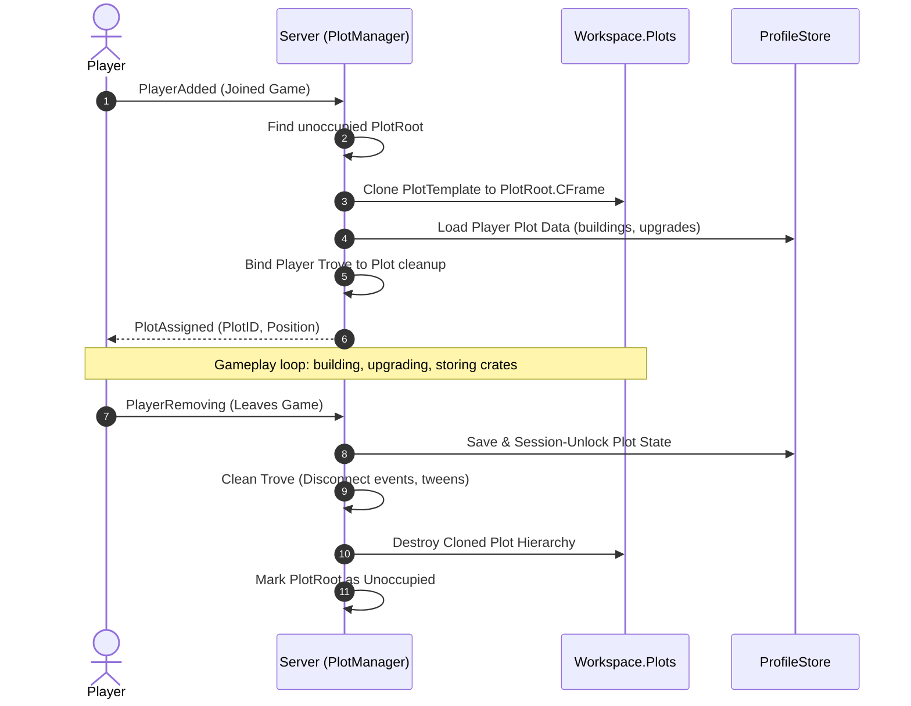

# 🏗️ Project: PlotTest

> **Modular plot base architecture and dynamic plot allocation engine.** Built with Rokit and Rojo 7.6.1, establishing an isolated sandbox for testing player base claiming, spatial isolation, dynamic model instancing, and clean Trove lifecycle boundaries for multiplayer Roblox simulators.

---

## 🗂️ Project Navigation Hub

| Section | Document | Description |
| :--- | :--- | :--- |
| 🏛️ **Architecture** | [[01 - Projects/PlotTest/Plot System Architecture\|Plot System Architecture]] | Claiming lifecycle, Trove memory bounds, spatial coordinate mapping. |
| 📋 **Global Sprint** | [[01 - Projects/Project Kanban\|Project Kanban]] | Active cross-project tasks and development milestones. |
| 📦 **Flagship Integration** | [[01 - Projects/Steal A Crate/Steal A Crate\|Steal A Crate]] | Target recipient of verified plot allocation modules. |

---

## 📌 Project Overview & Technical Setup

- **Local Repository:** `C:\Users\meepo\Documents\RobloxProjects\PlotTest`
- **Toolchain Manager:** Rokit (`rokit.toml` -> `rojo-rbx/rojo@7.6.1`)
- **Project Configuration:** `default.project.json`
- **Strict Typing:** `--!strict` enforced across all Luau files
- **Key Purpose:** Serve as the verified, modular foundation for all plot-based games (player plots, base building, conveyor placement, and safe-zone boundaries).

### Development Workflow

```bash
# Build binary or XML place file
rojo build -o "PlotTest.rbxlx"

# Start live sync server to Roblox Studio
rojo serve
```

---

## 🔄 Core Plot Lifecycle Flow



---

## 🛠️ Key Architectural Milestones

- [x] Initialized Rokit and Rojo 7.6.1 project structure.
- [x] Configured DataModel tree mapping (`Shared`, `Server`, `Client`).
- [ ] Implement `PlotManager` server service with thread-safe plot claiming.
- [ ] Implement spatial boundary fences with `CanQuery = false` performance optimization.
- [ ] Integrate Trove deterministic cleanup on plot unclaiming.
- [ ] Export production-ready module to `Steal A Crate` codebase.

---

## 👥 Related Vault Links
- Active Sprint: [[01 - Projects/Project Kanban|Project Kanban]]
- Architecture Spec: [[01 - Projects/PlotTest/Plot System Architecture|Plot System Architecture]]
- Luau Standards: [[02 - Areas/Roblox Luau Engineering|Roblox Luau Engineering]]
