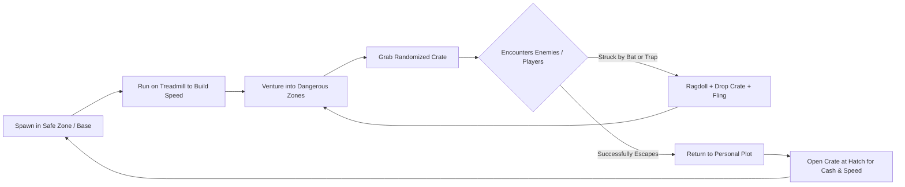

# 📦 Project: Steal A Crate

> **Fast-paced competitive Roblox simulator and physical heist game inspired by *Steal an Egg* and *Collect a Snack*.** Players run out into perilous zones, claim and carry randomized crates with realistic physics slowdown, dodge traps and enemy attacks, and deliver crates back to their personal plot base for cash rewards and speed progression.

---

## 🗂️ Project Navigation Hub

| Section | Document | Description |
| :--- | :--- | :--- |
| 🏗️ **Architecture** | [[01 - Projects/Steal A Crate/System Architecture\|System Architecture]] | Client/Server Luau structure, controllers, services, Knit/MVC data flow. |
| 🎮 **Game Design** | [[01 - Projects/Steal A Crate/Game Design Document\|Game Design Document]] | Core loop, crate weight & physics, zone progression, economy & combat. |
| 📊 **Analytics & Funnel** | [[01 - Projects/Steal A Crate/Analytics & Onboarding Funnel\|Analytics & Funnel]] | Step-by-step onboarding funnels (Tutorial: Purchase, Collect, Sell). |
| 📋 **Tasks & Progress** | [[01 - Projects/Steal A Crate/Tasks & Roadmap\|Tasks & Roadmap]] | Active sprint checklist, backlog, and completed features (Dataview/Tasks). |
| 📡 **Technical Specs** | [[01 - Projects/Steal A Crate/Technical Reference\|Technical Reference]] | RemoteEvents dictionary, sound asset registry, Check-UI standards. |

---

## 📌 Project Overview & Metadata

- **Platform:** Roblox (PC, Mobile, Console)
- **Place ID:** `139442706272264`
- **Target Audience:** Simulator & Tycoon players, social PvP heist enthusiasts
- **Local Repository:** `c:\Users\meepo\Documents\antigravity\Steal-A-Crate`
- **Design System:** `Check-UI` (GothamBlack typography, clean cartoon slate backgrounds, responsive UIScale engine `[0.52, 1.18]`)
- **Persistence Engine:** `ProfileStore`

---

## 🔄 Core Gameplay Loop

---

## 🛠️ Key Implemented Features

1. **Crate Carrying & Dynamic Physics**:
   - Random crate sizing and weight tiering.
   - Dynamic player carrying slowdown proportional to crate mass.
   - Dual-hand holding weld and drop mechanics.

2. **Full Ragdoll & Fling Combat Engine**:
   - Clean constraint-based ragdoll without character death.
   - Bat weapon: directional swing animation with front hitbox, flinging victims ~150 studs and forcing immediate crate drops.
   - Trap weapon: 5-stack placeable bear traps that auto-expire after 60s or trigger on contact, ragdolling and forcing crate drop.

3. **Plot & Base Architecture**:
   - Modular `PlotTemplate` dynamically cloned to `PlotRoot` points upon player join.
   - Player data auto-mapped to plot base elements.

4. **Treadmill & Speed Progression**:
   - Treadmill granting speed every 0.2s with ultra-fast UI floating popups (+Speed) tweening from center and fading out.

5. **Zone Transition UI (`Check-UI`)**:
   - Spatial heartbeat detection across `Forest 🙂`, `Beach 🏖️`, `Snow ❄️`, and `Safe Zone 🛡️`.
   - Permanent `Frame` in `StarterGui.Main.ZoneBanner` with dark slate gradient backdrop.
   - Solid, 100% opaque GothamBlack text and emoji with crisp black stroke.
   - Smooth `Enum.EasingStyle.Back` entrance and `Enum.EasingStyle.Quad` exit.

6. **Notification System**:
   - Ported notification stack from *Collect a Snack* with sound effects (`NotificationPop`, `SuccessSound`, `ErrorSound`).
   - 5 gradient presets: `Normal`, `Success`, `Robux`, `Rolled`, `Error`.

7. **Cross-Device UI Responsiveness & Check-UI Menus**:
   - Dynamic `getDeviceScale()` engine (`0.58` to `1.12`) bound to `Camera.ViewportSize` for modal windows (`PetIndexUI`, `ShopUI`, `SellUI`, `TrailShopUI`).
   - Universal `TextScaled = true` with `UITextSizeConstraint` ranges and text wrapping across all HUD and modal elements, preventing text overflow and collisions.
   - Non-overlapping layout geometry in `EquippedPetsUI` (`EquippedCount` vs `ExtraSlotButton`, `PetName` vs `UnequipButton`) and `GrowingCratesUI` (`Title` vs `GrowAllButton`).
   - Multi-column card anti-bleeding engine in `PetIndexUI` with container `ClipsDescendants = true` across all biomes.
   - Single-activation cross-platform `.Activated` bindings with debouncing to prevent double-click events and duplicate audio playback.
   - AnchorPoint `(0.5, 0.5)` centered bounce animations via `ButtonAnimationController`.

8. **Spatial Base Management & Kinesthetics**:
   - Spatial grid animal distribution on expanded base pens (`PenLevel > 1`) and dynamic wander boundaries.
   - Dynamic FOV camera expansion when carrying heavy crates and running on treadmills.
   - Purged join-time electric `MutationSound` audio artifacts across client and server.

9. **3D ViewportFrame UI Rendering**:
   - `PetIndexUI`: Dynamic 3D model rendering for all 32 biome pet cards and `PetDetails`. Discovered pets showcase vivid full-color models centered at `(0, 0, 0)` with continuous 360° turntable orbit animation, while undiscovered pets display mystery dark silhouettes with smooth plastic and hidden decals.
   - `GrowingCratesUI`: Real-time 3D crate previews inside `CrateViewport` with smooth turntable spin for both ready crates (`CrateReadyRow`) and growing crates (`CrateGrowingRow`), displaying the exact crate tier model.
   - `EquippedPetsUI`: Real-time 3D pet models inside `PetViewport` with smooth turntable spin for all equipped pets, integrated with `MutationModule` to dynamically render mutation materials, neons, and tints.

10. **Treadmill Tier 5 Progression Engine**:
    - Integrated `TreadmillLVL5` providing +40 Speed per tick (upgrade cost $35,000, max level 5). Fully synchronized with `TreadmillService`, `UpgradeSign`, and dynamically allocated `PlotTemplate` instances.

11. **Expanded Desert Entities & Biome Crates**:
    - Imported and registered `SandCentipede` (Mythic) and `SunkenPharaoh` (Secret) into `ReplicatedStorage.Assets.Entities` and `CharactersData`.
    - Integrated 8 imported biome crates across Snow (`FrostWoodCrate`, `IceboundCrate`, `AuroraRelicCrate`) and Desert (`DuneCrate`, `MirageCrate`, `SunkenSandsCrate`, `PharaohCrate`, `PrecursorCrate`) into `ReplicatedStorage.Assets.Crates` and mapped in `CratesData`.

12. **Roblox Open Cloud Animation Pipeline**:
    - Streamed and published 23 custom animations to the Domofon Games group (`858153940`) via the Assets API, automatically linking newly generated `rbxassetid`s directly into `ReplicatedStorage.Assets.Animations`.

---

## 👥 Related Vault Links
- Active Sprint: [[01 - Projects/Project Kanban|Project Kanban]]
- Category View: [[Categories/Projects|Projects Hub]] · [[Categories/Games|Games Hub]]
