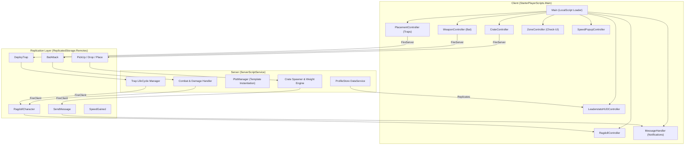

# 🏗️ Steal A Crate - System Architecture

> **Technical architecture, client-server separation, module dependencies, and data lifecycle for the *Steal A Crate* Roblox codebase.**

Parent Hub: [[01 - Projects/Steal A Crate/Steal A Crate|Steal A Crate]]

---

## 🏛️ High-Level System Overview

---

## 📱 Client Controllers Architecture

All client modules are loaded uniformly by `StarterPlayer.StarterPlayerScripts.Main`. The loader discovers all descendants, calls `Init(self)` concurrently via `task.spawn`, and then `Start(self)` concurrently via `task.defer`.

### 1. `CrateController`
- **Responsibility:** Manages crate interaction prompts, dual-arm hold welds, dynamic movement speed reduction based on crate mass, and drop requests.
- **Key Logic:**
  - Calculates proportional slowdown: `WalkSpeed = BaseSpeed * (1 - math.clamp(Mass / MaxMass, 0, 0.65))`.
  - Disables sprinting/jumping while holding overweight crates.
  - Automatically invokes drop on ragdoll or combat hit.

### 2. `RagdollController`
- **Responsibility:** Seamless physics ragdoll without player death (`BreakJointsOnDeath = false`).
- **Key Logic:**
  - Disables `Humanoid:SetStateEnabled(Enum.HumanoidStateType.GettingUp, false)`.
  - Replaces Motor6D joints with BallSocketConstraints and NoCollisionConstraints.
  - Automatically applies fling impulse (`AssemblyLinearVelocity`) when struck by enemies or bats.
  - Handles 2-3s recovery timer, rebuilding Motor6Ds and restoring upright humanoid physics.

### 3. `WeaponController` (Bat Combat)
- **Responsibility:** Mobile touch & LMB input detection, weapon swing animation, and directional hitbox raycast.
- **Key Logic:**
  - Non-looped swing animation track with cooldown guard.
  - Spatial overlap box detection in front of the player's `HumanoidRootPart`.
  - On valid player hit: sends `BatAttack` to server, triggering ~150 studs fling velocity and forced crate drop.

### 4. `PlacementController` (Trap System)
- **Responsibility:** Player trap inventory tracking (max 5 charges) and ground placement raycasting.
- **Key Logic:**
  - Prevents placement when stock is 0.
  - Raycasts downward to ensure traps align with terrain/floor geometry.
  - Traps auto-replenish either when triggered by an enemy/player or after the 60-second despawn timer expires.

### 5. `ZoneController` (Check-UI Engine)
- **Responsibility:** Real-time spatial monitoring of player Z-axis position to trigger responsive zone banners.
- **Key Logic:**
  - Reads `HumanoidRootPart.Position.Z` on a 0.15s polling heartbeat.
  - Zones: `Forest 🙂` (`[-140.5, -65.5]`), `Beach 🏖️` (`[-235.5, -140.5]`), `Snow ❄️` (`[<-235.5]`), `Safe Zone 🛡️` (`[>-65.5]`).
  - Animates `StarterGui.Main.ZoneBanner` via `TweenService`:
    - In-tween: `Back.Out` (0.5s) to `{0.5, 0}, {0.14, 0}`.
    - 100% solid GothamBlack typography and emoji with black stroke.
    - Hold: 2.6s.
    - Out-tween: `Quad.In` (0.4s) to `{0.5, 0}, {0.06, 0}`.

### 6. `SpeedPopupController`
- **Responsibility:** Renders floating floating numerical feedback when training speed on treadmills.
- **Key Logic:**
  - Rate: triggers every 0.2s while active on treadmill.
  - Fast pop animation: scales and translates upward 3x faster than standard notifications, fading out cleanly via CanvasGroup transparency.

### 7. `MessageHandler` (Notification Engine)
- **Responsibility:** Pop-up alert stack in `PlayerGui.Main.Messages` ported from *Collect a Snack*.
- **Key Logic:**
  - Sound cues: `NotificationPop`, `SuccessSound`, `ErrorSound`, `ButtonClick`.
  - 5 gradient presets: `Normal`, `Success`, `Robux`, `Rolled`, `Error`.
  - Exponential spring scale-in and clean quad fade-out.

---

## 🖥️ Server Systems Architecture

### 1. `PlotManager` (Modular Base System)
- Replaces static workspace plots with a clean root-instantiation engine.
- Spawns a clean clone of `ReplicatedStorage.Templates.PlotTemplate` at each player's assigned `PlotRoot` CFrame upon joining.
- Ensures map updates and plot balance tweaks only require editing the single master template.

### 2. `ProfileStore` (Data Persistence)
- Manages persistent player state:
  - `Cash`: Currency earned from crate delivery.
  - `Speed`: Accumulated treadmill speed stat.
  - `UnlockedAreas`: Progression barriers unlocked.
  - `Inventory`: Weapons and equip state.

### 3. Combat & Fling Server Verifier
- Validates melee hitboxes and trap triggers on the server to prevent physics exploits.
- Enforces network ownership handoffs during ragdoll flings to ensure smooth ragdoll replication across all clients.

---

## 🔗 Architecture & Pipeline Links
- Networking Engine: [[03 - Resources/Packet Networking Library|Packet Networking Library]]
- Spatial Trigger Volumes: [[03 - Resources/ZonePlus Spatial Engine|ZonePlus Spatial Engine]]
- Data Persistence Standard: [[03 - Resources/PlayerData & ProfileStore Architecture|PlayerData & ProfileStore Architecture]]
- Funnel Tracking: [[01 - Projects/Steal A Crate/Analytics & Onboarding Funnel|Steal A Crate Analytics & Funnel]]
- Open Cloud Assets: [[03 - Resources/Roblox Open Cloud Asset Pipeline|Roblox Open Cloud Asset Pipeline]]
- UI Design System: [[02 - Areas/Check-UI Design System|Check-UI Design System]]
