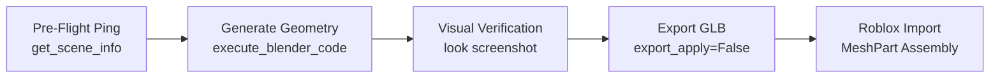

# 🎨 Area: Blender Modeler & 3D Art

> **Production 3D modeling and automated Roblox Studio pipeline via Blender MCP.**  
> Defines the visual craftsmanship, tactile bevel geometry, Studs & Weld material architecture, and skinned armature rigging for stylized chunky voxel simulators.

---

## 🛑 Absolute Mandate: Blender MCP Execution Only

> [!CAUTION]
> ### Strict Prohibition: Never Generate Raw Luau Primitives
> Never write Luau scripts that generate models out of raw `Instance.new("Part")`, `Instance.new("WedgePart")`, or welded primitive assemblies. Raw parts cause catastrophic physics lag, destroy network replication budgets, have broken bounding boxes, and cannot use vertex skinning.
> 
> All 3D modeling MUST be authored inside Blender via the `blender` MCP tools (`get_scene_info`, `execute_blender_code`, `look`) and exported cleanly to `.glb` format.

---

## 💎 The 6 Golden Rules of the Stylized Chunky Voxel Aesthetic

1. **Tactile Edge Bevels (The Anti-Razor Rule):**
   - **NEVER** leave raw, razor-sharp 90° Cartesian edges on major volumes.
   - Every major volume must have tactile beveled edges (width `0.04 - 0.15` units, 2 segments, profile `0.5`). This catches rim lighting in Roblox Studio and gives objects their soft vinyl/toy aesthetic.
2. **Stepped Voxel Silhouette Staging:**
   - Silhouettes (tree crowns, rock terraces, crab carapaces, crate overlays) are shaped through bold, stepped tiers of axis-aligned volumes.
3. **Smooth Shading with Angle Preservation:**
   - Polygons on curved/beveled elements use smooth shading with sharp angle preservation (auto-smooth angle `30° - 35°` via `bpy.ops.object.shade_smooth_by_angle(angle=math.radians(35))`).
4. **Selective Curved & Cylindrical Elements:**
   - Organic details naturally demand curves: horns, tentacles, shells, ropes, and glowing core spheres. Use clean 8-16 sided beveled cylinders and curved arcs.
5. **Dual MaterialVariant Architecture (Studs for Wood/Plastic + Weld for Metal):**
   - Geometry is cubic-projected (`cube_size = 1.0`).
   - In Roblox Studio:
     - Organic bodies, carapaces, foliage, rocks, and wooden crate slats -> `MaterialVariant = "Studs"` (`BaseMaterial = Plastic`).
     - Metallic corner brackets, iron reinforcement bands, gym equipment frames -> `MaterialVariant = "Weld"` (`BaseMaterial = Plastic`).
     - Glowing cores, crystals, and runes -> `Material = Enum.Material.Neon` with `MaterialVariant = ""`.
6. **True Skinned Armature Rigging (Never Rigid Multi-Part Welding):**
   - All creatures, pets, and humanoid NPCs are rigged to a single **Armature** with a hierarchical bone skeleton.
   - Each color-separated mesh is parented to the Armature with an Armature Modifier, with vertices assigned to Vertex Groups matching bone names at rigid weight `1.0`.

---

## 🎨 Multi-Part Color & Material Architecture

Roblox `MeshPart`s can only have a single `Color` and a single `MaterialVariant`. Therefore, models in Blender must be split by color/material into separate child objects sharing the exact same origin $(0, 0, 0)$:

```text
Blender Object Name       ->  Roblox BrickColor / Material Mapping
-----------------------------------------------------------------------
Prop_Body_Red             ->  BrickColor.new("Bright red")       [Studs]
Prop_Bands_DarkGrey       ->  BrickColor.new("Dark stone grey")  [Weld]
Prop_Trim_Gold            ->  BrickColor.new("Warm gold")        [Weld]
Prop_Glow_Cyan            ->  BrickColor.new("Electric blue")    [Neon]
```

---

## 🛠️ Blender MCP Execution Pipeline



1. **Pre-flight Sanity Check:** Verify connection via `get_scene_info`.
2. **Execute Code:** Build geometry, apply tactile bevels, create bone weights.
3. **Visual Audit:** Render camera snapshot via `look` (`max_size: 768`).
4. **Export:** Save `.glb` to asset directory with unapplied modifiers (`export_apply=False`) to preserve bone rigging.

---

## 🔗 Related Vault Links
- Python Script Recipes: [[03 - Resources/Blender MCP Automation Recipes|Blender MCP Automation Recipes]]
- Level Integration: [[02 - Areas/World Building & Level Design|World Building & Level Design]]
- Pipeline Management: [[02 - Areas/Roblox Asset Pipeline|Roblox Asset Pipeline]]
- Active Heist Props: [[01 - Projects/Steal A Crate/Steal A Crate|Steal A Crate]]
