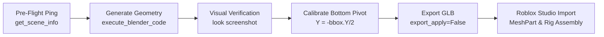

# 🎨 Area: Blender Modeler & 3D Art

> **Production 3D modeling, texturing architecture, and character animation specification for Roblox Studio via Blender MCP.**  
> Defines the visual craftsmanship, tactile bevel geometry, multi-part MaterialVariant system, volumetric 3D eye anatomy, dual rigging architectures (Skinned Armature vs. Rigid WeldConstraint), and snappy 24 FPS animation kinematics.

---

## 🛑 Absolute Mandate: Blender MCP Execution Only

> [!CAUTION]
> ### Strict Prohibition: Never Generate Raw Luau Primitives
> Never write Luau scripts that generate models out of raw `Instance.new("Part")`, `Instance.new("WedgePart")`, or unmodeled primitive assemblies. Raw part unions cause catastrophic physics lag, destroy network replication budgets, have broken bounding boxes, and cannot support vertex skinning or clean UV projections.
> 
> All 3D models and character rigs MUST be authored inside Blender via the `blender` MCP tools (`get_scene_info`, `execute_blender_code`, `look`) and exported cleanly to `.glb` format.

---

## 💎 The 7 Golden Rules of the Stylized Chunky Voxel Aesthetic

1. **Tactile Edge Bevels (The Anti-Razor Rule):**
   - **NEVER** leave raw, razor-sharp 90° Cartesian edges on major volumes.
   - Every major volume must have tactile beveled edges (width `0.04 - 0.15` units, 2 segments, profile `0.5`). This catches rim lighting in Roblox Studio and gives objects their soft vinyl/toy collector aesthetic.
2. **Stepped Voxel Silhouette Staging:**
   - Silhouettes (tree crowns, rock terraces, crab carapaces, crate overlays) are shaped through bold, stepped tiers of axis-aligned volumes.
3. **Smooth Shading with Angle Preservation:**
   - Polygons on curved/beveled elements use smooth shading with sharp angle preservation (auto-smooth angle `30° - 35°` via `bpy.ops.object.shade_smooth_by_angle(angle=math.radians(35))`).
4. **Selective Curved & Cylindrical Elements:**
   - Organic details naturally demand curves: horns, tentacles, shells, ropes, and glowing core spheres. Use clean 8-16 sided beveled cylinders and curved arcs.
5. **Quad MaterialVariant Architecture (`Studs`, `Weld`, `Universal`, `Glue` + `Neon`):**
   - Geometry is cubic-projected (`cube_size = 1.0`).
   - In Roblox Studio, visual character is achieved through specialized `MaterialVariant`s mapped over `BaseMaterial = Plastic`:
     - **`Studs` (`Plastic`):** Organic bodies, creature fur, chitin carapaces, foliage, rocks, and wooden crate slats. Gives tactile classic toy cylinder stud texture.
     - **`Weld` (`Plastic`):** Metallic corner brackets, iron reinforcement bands, rusty armor plates, gym equipment frames.
     - **`Universal` (`Plastic`):** Smooth synthetic casings, clean pedestals, and polished ice/metal trims (e.g. `AuroraRelicCrate`).
     - **`Glue` (`Plastic`):** Ancient stone/gold inlays, desert artifacts, and ceremonial metals (e.g. `PharaohCrate`).
     - **`Neon` (`Enum.Material.Neon`):** Glowing venom cores, magical runes, crystal shards, and emissive eyes.
6. **Dual Rigging Architecture (Skinned Armature for Entities, Rigid Welds for Props):**
   - **Creatures & Entities:** Built with a true hierarchical **Armature** parented under `RootPart`. Color-separated MeshParts are connected to `RootPart` via `Motor6D`s for replication, while vertex groups are skinned to the Armature's bones with rigid/weighted assignments.
   - **Crates & Environmental Props:** Built as rigid multi-part assemblies connected via `WeldConstraint`s to a central `PrimaryPart`.
7. **Strict Bottom-Aligned Pivot Specification:**
   - **EVERY** crate, prop, and world model must have its Model Pivot calibrated exactly to the **bottom face** of its bounding box (`PrimaryPart.PivotOffset = PrimaryPart.CFrame:ToObjectSpace(bottomCFrame)`).
   - This guarantees that `:PivotTo()` at ground level rests the prop 100% flush on terrain and plot floors with 0.000 studs penetration at all scales (`Regular 1.0x`, `Huge 1.8x`, `Colossal 3.5x`).

---

## 👁️ Volumetric 3D Eye Anatomy

In-game creatures feature **100% 3D beveled mesh geometry** for facial features—never flat 2D decals or texture maps:

1. **Sclera / Base Volume:** Beveled pill or oval mesh (`White` MeshPart) forming the eye socket backdrop.
2. **Pupil & Iris:** High-contrast `Really black` or tinted beveled disc (`Eyes` / `Black` / `Pupil.L/R` MeshPart) slightly extruded forward.
3. **Catchlight Highlight:** Tiny forward-offset white spherical or disc highlight giving lifelike vitality.
4. **Articulated Eyebrows / Eyelids:** Dedicated bones (`Eyebrow.L`, `Eyebrow.R`, `Eye.L`, `Eye.R`) integrated into the character's Armature, enabling dynamic blinking, inquisitive tilts, and angry combat squints.

---

## 🎬 Animation Kinematics & Timing Standards

All animations in `Steal A Crate` are authored to a strict **24 FPS** cadence with smooth cubic interpolation:

```text
Animation Archetype    Length (Frames / Sec)    Loop?    Priority    Key Movement Characteristics
-------------------------------------------------------------------------------------------------------------
Entity Idle            48 frames / 1.96s - 2.46s  Yes     Action      Gentle Y-axis breathing bounce (~0.12 studs),
                                                                      subtle ear/tail twitches, secondary tentacle/chitin ripples.
Entity Walk / Run      21 - 24 frames / 0.83s - 0.96s Yes   Action      Snappy, rhythmic stride; exaggerated body tilt;
                                                                      IK-planted foot contacts (zero foot sliding).
Combat Swing (Bat)     24 frames / 1.0s          No      Action      Fast 4-frame windup -> 2-frame snap swing ->
                                                                      settling follow-through.
Boss Trigger / Hit     48 - 72 frames / 2.0s - 3.0s No   Action      Heavy recoil / roar, ground pound with shockwave timing.
```

### Key Rigging & IK Rules:
- **IK Foot Constraints:** Multi-legged creatures (`KingCrab`: 6 legs; `SandCentipede`: 10 legs; `Glaceclaw`: 4 legs) feature dedicated IK targets (`FrontLeg-IK.L/R`, `Foot.IK.L/R`, `BackLeg-IK.L/R`), locking foot placement during ground contact.
- **Segmented Spine & Tail Chains:** Arthropod and serpentine creatures (`SandCentipede`, `Octopus`) feature 4 to 8 articulated sub-bones per tentacle/segment, creating fluid sinusoidal wave motion during locomotion.

---

## 📦 Crate & Prop Architectural Specification

```
Crate Anatomy (2.16 x 2.16 x 2.16 studs baseline)
├── Core Body (MeshPart: Studs / Universal Plastic)
├── Corner Brackets & Straps (MeshParts: Weld / Glue Plastic)
├── Beveled Chamfer Lids (MeshParts: 45° rim-light bevels)
├── Emissive Insets (MeshParts: Neon runes / crystal shards on high tiers)
└── Central PrimaryPart (Anchored, CanCollide = true, PivotOffset at Y = -Size.Y/2)
```

- **Biome Theming:**
  - **Forest:** Weathered pine planks (`Studs`), dark iron straps (`Weld`), emerald rune inlays (`Neon`).
  - **Beach:** Driftwood slats, barnacle crusts, sea-glass inserts, coral overgrowths.
  - **Snow:** Glacial blue ice blocks (`Universal`), frosted timber, aurora crystal clusters (`Neon`).
  - **Desert:** Sun-bleached sandstone (`Studs`), weathered bronze bands (`Weld`), glowing hieroglyphic cylinders (`Neon`), gold foil inlays (`Glue`).

---

## 🏃 Treadmill Machinery & Progression Design

- **Chassis Architecture:** Heavy industrial steel frame with tactile edge bevels, side safety rails, and front support posts.
- **Conveyor Belt:** Wide tactile ribbed tread belt with high-contrast safety stripes.
- **Telemetry Console:** Ergonomic dashboard with digital speedometer, pulse readout panel, and high-visibility status lighting.
- **Tier Progression (LVL 1 - LVL 5):**
  - **LVL 1:** Compact wooden/sheet metal starter frame (+1 Speed).
  - **LVL 2:** Standard black steel frame with rubber belt (+3 Speed).
  - **LVL 3:** Reinforced dual-cylinder chassis with chrome trim (+8 Speed).
  - **LVL 4:** Heavy performance treadmill with digital HUD screen (+20 Speed).
  - **LVL 5:** Industrial Colossal sprint station (`TreadmillLVL5`: primary part `Black`, +40 Speed) with high-output neon status runners and hydraulic dampeners.

---

## 🛠️ Blender MCP Execution Pipeline



1. **Pre-flight Sanity Check:** Verify Blender server connectivity via `get_scene_info`.
2. **Execute Code:** Generate beveled geometry, separate objects by color/material, and create bone armatures.
3. **Visual Audit:** Render camera snapshot via `look` (`max_size: 768`).
4. **Calibrate Pivot:** Ensure the origin or model base is set to the bottom contact plane.
5. **Export:** Save `.glb` with unapplied modifiers (`export_apply=False`) to preserve bone rigging and armatures.
6. **Studio Import:** Map `MaterialVariant`s, create `Motor6D`s for characters or `WeldConstraint`s for props, and verify bottom-aligned pivot.

---

## 🔗 Related Vault Links
- Python Automation Recipes: [[03 - Resources/Blender MCP Automation Recipes|Blender MCP Automation Recipes]]
- Technical Reference: [[01 - Projects/Steal A Crate/Technical Reference|Technical Reference]]
- Level Assembly: [[02 - Areas/World Building & Level Design|World Building & Level Design]]
- Pipeline Management: [[02 - Areas/Roblox Asset Pipeline|Roblox Asset Pipeline]]
- Active Project: [[01 - Projects/Steal A Crate/Steal A Crate|Steal A Crate]]
