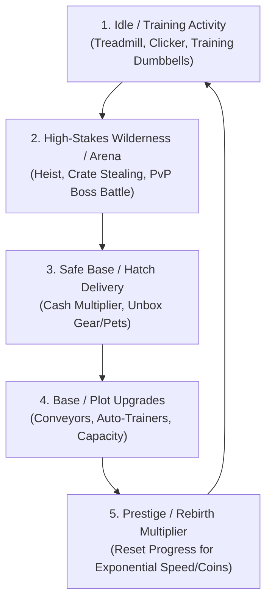

# 🎯 Area: Game Design & Production

> **Game design documentation (GDD), retention mechanics, simulator monetization loops, and telemetry analytics.**  
> Formatted according to VoltAgent awesome-agent-skills specifications and top-grossing Roblox simulator design frameworks.

---

## 🔁 The Canonical Simulator Loop

Top-performing Roblox simulators (Pet Simulator 99, Arm Wrestle Simulator, Blade Ball) rely on a tight, satisfying multi-tier positive feedback loop:

---

## 📑 The Two Technical Specification Archetypes

### Archetype A: Technical Feature Spec (Atomic Execution)
Use when designing discrete systems, weapons, or UI features.
- **Section 1: Specification & User Story**
  - One-line purpose, actors, functional requirements, edge cases, binary acceptance criteria (`Given / When / Then`).
- **Section 2: Architecture & Technical Plan**
  - Mermaid data flow, typed data models, remote event API contracts, Trove lifecycle constraints.
- **Section 3: Atomic Task Breakdown**
  - Ordered, self-contained subagent tasks with single ownership (Programmer, Builder, UI Designer, Modeler) and binary acceptance checks.

### Archetype B: Master Game Planning Document (Authoritative GDD)
Use when architecting a full game from scratch across all 11 required sections:
1. Executive Summary & Market Fit
2. Core Gameplay Loops & Pillars
3. Mechanics, Physics, & Controls
4. Economy, Currencies, & Monetization
5. Progression, Unlocks, & Rebirth Multipliers
6. Environment, Biomes, & 7 Asset Layers
7. User Interface Specification (`Check-UI`)
8. Sound & Visual Effects (VFX/SFX)
9. Technical Architecture & Networking
10. Analytics, Retention Funnels, & Churn Mitigation
11. Atomic Production Roadmap

---

## 📊 AnalyticsService Funnel & Churn Tracking

To maximize Day 1 (D1) and Day 7 (D7) retention, games must track atomic milestone funnels via `AnalyticsService`:

1. `Onboarding_Spawn` -> Initial player load.
2. `Onboarding_FirstTraining` -> Player steps onto treadmill / training pad within 30s.
3. `Onboarding_FirstCrateGrab` -> Player ventures into wilderness and collects first crate.
4. `Onboarding_FirstDelivery` -> Crate deposited at base hatch; first cash reward claimed.
5. `Economy_FirstUpgrade` -> First plot or speed upgrade purchased.
6. `Progression_FirstRebirth` -> Player triggers first rebirth.

*Any dropoff greater than 20% between adjacent funnel steps indicates a friction point requiring UI simplification or immediate camera waypoint guidance.*

---

## 🔗 Related Vault Links
- Active Flagship GDD: [[01 - Projects/Steal A Crate/Game Design Document|Steal A Crate Game Design Document]]
- Active Tasks & Sprint: [[01 - Projects/Steal A Crate/Tasks & Roadmap|Steal A Crate Tasks & Roadmap]]
- UI Design System: [[02 - Areas/Check-UI Design System|Check-UI Design System]]
- Luau Engineering: [[02 - Areas/Roblox Luau Engineering|Roblox Luau Engineering]]
