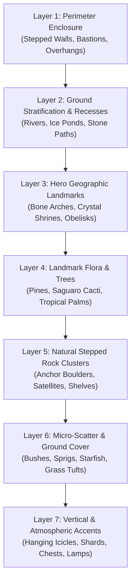

# 📦 Area: Roblox Asset Pipeline

> **Central asset pipeline coordinator and multi-agent workflow orchestration.**  
> Translates game design specifications into rich, multi-category asset bundles, establishes zone density budgets, and enforces the 18–24 archetype rule.

---

## 🛑 The Critical Defect: Sparse Manifests & Empty Maps

> [!CAUTION]
> ### Strict Prohibition: Never Issue Sparse 3–4 Item Manifests
> Issuing minimal manifests with only 3–4 assets (e.g. 1 chest, 1 rock, 1 tree) produces barren, boring void baseplates.
> 
> For every game zone or simulator arena, you **MUST mandate a comprehensive manifest containing a MINIMUM of 18 to 24 distinct asset archetypes** across all 7 environmental layers.

---

## 🌲 The 7 Environmental Asset Layers

Every environment must be populated across all 7 distinct structural and visual layers:

| Layer | Archetype Examples | Purpose |
| :--- | :--- | :--- |
| **L1: Perimeter Enclosure** | Stepped cliff walls, 90° corner bastions, rock overhangs | Cleanly bounds the map with verticality; prevents void horizons. |
| **L2: Ground Stratification** | Recessed river channels (-1 to -2 studs), frozen ponds, stone paths | Ensures the ground is never a flat, boring plane. |
| **L3: Hero Landmarks** | Giant dinosaur rib cage arches, floating crystal shrines | Provides orientation and dramatic player focus points. |
| **L4: Landmark Flora** | Tiered snow pines, saguaro cacti with dual 90° arms, palms | Establishes biome identity and organic vertical silhouette. |
| **L5: Rock Clusters** | Stepped anchor boulders, flanking satellite stones, flat shelves | Organic natural cover and terrain stepping. |
| **L6: Micro-Scatter** | Round voxel bushes, grass sprigs, starfish (`CanCollide = false`) | High-density visual ground dressing. |
| **L7: Vertical Accents** | Hanging icicles, ground crystal spikes, post lanterns, chests | Ceiling and air space enrichment. |

---

## 📊 Zone Density Budget Guidelines

| Asset Category | Target Count per $200 \times 200$ Stud Zone |
| :--- | :--- |
| **Perimeter Bastions & Walls** | 16 – 28 modules |
| **Hero Centerpiece Landmarks** | 1 – 3 structures |
| **Landmark Trees / Flora** | 18 – 35 instances |
| **Anchor Rock Clusters** | 8 – 14 clusters (3–5 stones each) |
| **Micro-Scatter & Bushes** | 60 – 120 instances |
| **Vertical Accents & VFX** | 12 – 24 props |

---

## 🔗 Related Vault Links
- Biome Checklist: [[03 - Resources/7 Environmental Layers Biome Checklist|7 Environmental Layers Biome Checklist]]
- 3D Modeling via Blender: [[02 - Areas/Blender Modeler & 3D Art|Blender Modeler & 3D Art]]
- Level Assembly: [[02 - Areas/World Building & Level Design|World Building & Level Design]]
- Local Assets: [[03 - Resources/Local Audio & UI Asset Catalog|Local Audio & UI Asset Catalog]]
