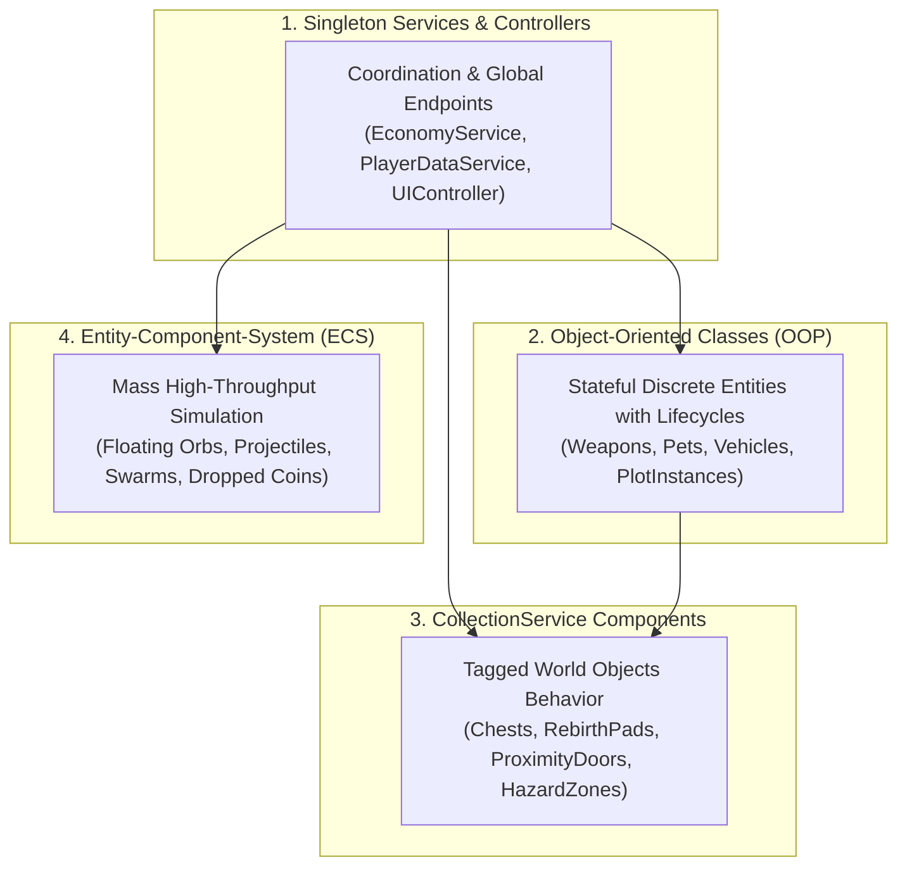

# ⚡ Area: Roblox Luau Engineering

> **Production engineering standards, architectural design patterns, and exploit-resistant network models for professional Roblox Studio games.**  
> Grounded in strict typing, zero-trust server validation, Trove deterministic memory lifecycles, and modular services.

---

## 🏛️ The 4 Cardinal Architectural Patterns

Roblox experiences must strictly separate responsibilities into four distinct architectural layers based on data ownership and simulation throughput:



| Pattern | Primary Domain | Memory Management | Key Characteristics |
| :--- | :--- | :--- | :--- |
| **Singleton Service / Controller** | Global coordination, remotes, external APIs, persistent game loops. | Initialized at boot; lives for server lifetime. | Service-Controller pattern; cross-communicates via `require`. |
| **Object-Oriented Programming (OOP)** | Discrete stateful game entities with identity and lifespan. | Owned by a `Trove`; explicit `:Destroy()` method. | Metatables with `__index`; sealed typed table constructors. |
| **CollectionService Components** | 3D Workspace models placed by level designers. | Lifecycle bound to `GetInstanceAddedSignal` and instance deletion. | Single responsibility bound to tag; zero code embedded inside parts. |
| **Entity-Component-System (ECS)** | Thousands of uniform, lightweight spatial entities. | Flat arrays / continuous typed buffers. | Pure data tables, integer IDs, zero-allocation iterators on `Heartbeat`. |

---

## 📜 The Non-Negotiable Engineering Rules

1. **Section Header Comments Policy:**
   - The only allowed comments in Luau production code are structural section headers formatted as:
     `--[SERVICES]--`, `--[MODULES]--`, `--[VARIABLES]--`, `--[FUNCTIONS]--`, `--[INITIALIZATION]--`, `--[DATASTORE]--`, `--[PACKETS]--`, etc.
   - All other inline comments, conversational chatter, and docstrings are strictly forbidden. Code must be self-documenting through explicit strict type annotations (`--!strict`).
2. **Zero Prints Policy:**
   - Production code must never execute `print(...)`.
   - Alert developers strictly through `warn(...)` for actionable errors.
   - Track analytics through `AnalyticsService` and [[03 - Resources/Analytics & Onboarding Funnel Architecture|Analytics Funnels]].
3. **Zero Procedural UI Generation:**
   - Never instantiate UI hierarchies via code (`Instance.new("ScreenGui")`, `Instance.new("Frame")`, etc.).
   - All UI must be pre-built in `StarterGui` under [[02 - Areas/Check-UI Design System|Check-UI]] guidelines. Luau programmers only perform **Controller Binding**.
4. **100% Strict Type Safety (`--!strict`):**
   - Every file begins with `--!strict`.
   - Export explicit type definitions for network payloads, state objects, and class tables.
5. **Modern Networking & Spatial Volumes:**
   - Network communication is standardized on [[03 - Resources/Packet Networking Library|Packet]] (binary buffer packing).
   - Dynamic spatial zones are standardized on [[03 - Resources/ZonePlus Spatial Engine|ZonePlus v3.2.0]] (zero-drag volume triggers).
6. **Server-Authoritative Networking (Zero-Trust Client):**
   - Clients send *intent* only (e.g., `RequestBuyItem`, `RequestSwingBat`).
   - The server validates cooldowns, prices, inventories, and spatial raycast distance.
   - Enforce zero-allocation token-bucket rate limiters on all incoming packets.
7. **Atomic DataStore Session Locking:**
   - Player persistence is standardized on [[03 - Resources/PlayerData & ProfileStore Architecture|ProfileStore]], enforcing auto-reconciliation, session locking, and clean studio/live segregation.
8. **Deterministic Memory Cleanup (Trove / Janitor):**
   - Never leave event connections or tweens dangling.
   - Every class, component, and temporary visual effect must be tied to a `Trove`.
9. **Modern Task Library Exclusivity:**
   - Never use `wait()`, `spawn()`, or `delay()`.
   - Always use `task.wait()`, `task.spawn()`, `task.defer()`, `task.delay()`, `task.cancel()`.
10. **Player Lifecycle Completeness:**
   - Always iterate existing players (`for _, player in Players:GetPlayers() do`) upon service boot before connecting `Players.PlayerAdded`.
   - Always release player locks and state on `Players.PlayerRemoving`.ing (Zero-Trust Client):**
   - Clients send *intent* only (e.g., `RequestBuyItem`, `RequestSwingBat`).
   - The server validates cooldowns, prices, inventories, and spatial raycast distance.
   - Enforce zero-allocation token-bucket rate limiters on all incoming remote events.
6. **Deterministic Memory Cleanup (Trove / Janitor):**
   - Never leave event connections or tweens dangling.
   - Every class, component, and temporary visual effect must be tied to a `Trove`.
7. **Modern Task Library Exclusivity:**
   - Never use `wait()`, `spawn()`, or `delay()`.
   - Always use `task.wait()`, `task.spawn()`, `task.defer()`, `task.delay()`, `task.cancel()`.
8. **Player Lifecycle Completeness:**
   - Always iterate existing players (`for _, player in Players:GetPlayers() do`) upon service boot before connecting `Players.PlayerAdded`.
   - Always release player locks and state on `Players.PlayerRemoving`.

---

## 🗄️ Standard Directory Standard

```text
ReplicatedStorage/Shared
├── Config          # Static balance tables, constants, asset registries
├── Classes         # Replicated OOP class modules
├── Components      # ECS component definitions
├── Modules         # Trove, FastSignal, ObjectPool, RateLimiter
├── Remotes         # RemoteEvents, RemoteFunctions
└── Types           # Strict type contracts
ServerScriptService/Server
├── Services        # PlayerDataService, EconomyService, PlotService
├── Classes         # Server-side entity classes
├── Components      # CollectionService tagged world components
└── Systems         # ECS simulation systems
```

---

## 🔗 Related Vault Links
- Active Project: [[01 - Projects/Steal A Crate/System Architecture|Steal A Crate System Architecture]]
- Active Project Funnel: [[01 - Projects/Steal A Crate/Analytics & Onboarding Funnel|Steal A Crate Analytics & Funnel]]
- Networking: [[03 - Resources/Packet Networking Library|Packet Networking Library]]
- Spatial Zones: [[03 - Resources/ZonePlus Spatial Engine|ZonePlus Spatial Engine]]
- Persistence: [[03 - Resources/PlayerData & ProfileStore Architecture|PlayerData & ProfileStore Architecture]]
- Funnels: [[03 - Resources/Analytics & Onboarding Funnel Architecture|Analytics & Onboarding Funnel Architecture]]
- Open Cloud Pipeline: [[03 - Resources/Roblox Open Cloud Asset Pipeline|Roblox Open Cloud Asset Pipeline]]
- Modular Sandbox: [[01 - Projects/PlotTest/PlotTest|PlotTest]]
- Production Templates: [[03 - Resources/Luau Production Cheatsheet|Luau Production Cheatsheet]]
- UI Binding: [[02 - Areas/Check-UI Design System|Check-UI Design System]]
