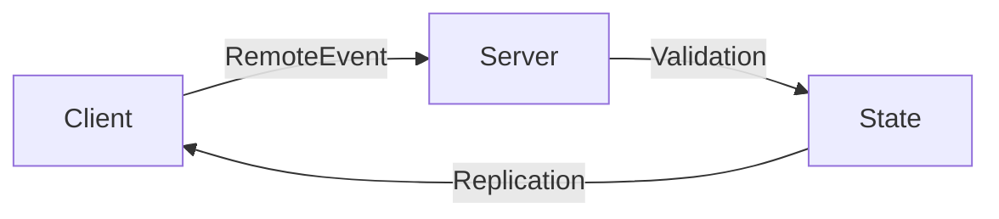

# 📋 {{title}} - Technical Specification

> **Specification & execution plan for {{title}} following the professional-documentation standard.**

---

## SECTION 1: SPECIFICATION & USER STORY

- **One-line Purpose:** 
- **Stakeholders & Actors:** Player, Server, Subagent.
- **Functional Requirements:**
  1. 
  2. 
  3. 
- **Edge Cases & Failure Modes:**
  - Network lag / dropped packets:
  - Player disconnection during interaction:
  - Boundary violations:
- **Acceptance Criteria (Given / When / Then):**
  - Given 
  - When 
  - Then 

---

## SECTION 2: ARCHITECTURE & TECHNICAL PLAN

- **System Architecture & Data Flow:**


- **Data Models & Strict Luau Types:**
```luau
--!strict
export type {{title}}Payload = {

}
```

- **API Contracts & Network Interfaces:**
  - `RemoteEvent`: 
  - Parameters: 

- **Security & Validation Constraints:**
  - Rate limiting (token-bucket):
  - Spatial sanity check (`(clientPos - targetPos).Magnitude <= maxRange`):

---

## SECTION 3: ATOMIC TASK BREAKDOWN

- [ ] **Task 1: Server Service & State Logic**
  - **Owner:** Programmer
  - **Inputs:** Type definitions
  - **Produces:** `ServerScriptService.Server.Services.{{title}}Service.luau`
- [ ] **Task 2: Client Controller & Check-UI Binding**
  - **Owner:** Programmer / UI Designer
  - **Produces:** `StarterPlayerScripts.Client.Controllers.{{title}}Controller.luau`
- [ ] **Task 3: Verification & Playtesting**
  - **Acceptance Criteria:** Given/When/Then verified in Studio playtest.
