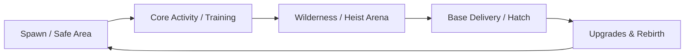

# 🎮 Project: {{title}}

> **One-sentence high-concept summary of the Roblox experience.**

---

## 🗂️ Project Navigation Hub

| Section | Document | Description |
| :--- | :--- | :--- |
| 🏗️ **Architecture** | [[System Architecture]] | Client/Server Luau structure, controllers, services. |
| 🎮 **Game Design** | [[Game Design Document]] | Core loop, progression curves, monetization, retention. |
| 📋 **Tasks & Roadmap** | [[Tasks & Roadmap]] | Sprint checklist and backlog powered by `Tasks`. |
| 📡 **Technical Specs** | [[Technical Reference]] | RemoteEvents dictionary, sound asset registry, UI hierarchy. |

---

## 📌 Project Overview & Metadata

- **Platform:** Roblox (PC, Mobile, Console)
- **Place ID:** ``
- **Target Audience:**
- **Local Repository:**
- **Design System:** [[02 - Areas/Check-UI Design System|Check-UI]]
- **Data Persistence:** `ProfileStore`

---

## 🔄 Core Gameplay Loop

---

## 🛠️ Key Implemented Features

1. 
2. 
3. 

---

## 👥 Related Vault Links
- Global Sprint: [[01 - Projects/Project Kanban|Project Kanban]]
- Luau Standards: [[02 - Areas/Roblox Luau Engineering|Roblox Luau Engineering]]
- UI Framework: [[02 - Areas/Check-UI Design System|Check-UI Design System]]
